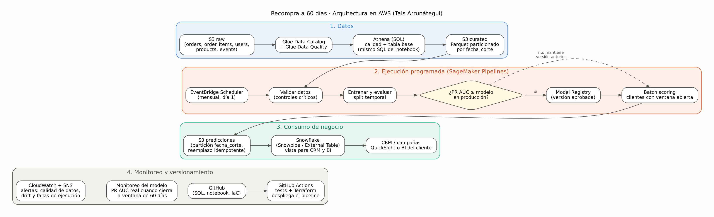

# Arquitectura en AWS

La idea es que lo que está en el notebook pase a producción casi igual: el mismo SQL y las mismas funciones de Python, cambiando solo quién los ejecuta. Preferí servicios administrados para no tener servidores que mantener.

## 1. Datos

Los sistemas fuente dejan archivos por tabla y por fecha en **S3** (`raw/orders/dt=YYYY-MM-DD/`, etc.). Un crawler de **Glue** los registra en el **Data Catalog** y **Glue Data Quality** corre las mismas reglas de `00a_calidad_fuentes.sql` (claves únicas, nulos, integridad).

La tabla base la construiría con **Athena**, porque `01_tabla_base.sql` pasa con cambios mínimos y el volumen es tabular. Glue con Spark lo dejaría para cuando Athena se quede corto. El resultado va a una zona *curated* en S3, en Parquet y particionado por `fecha_corte`.

## 2. Ejecución

**EventBridge Scheduler** lanza una vez al mes un **SageMaker Pipeline** con los mismos pasos del notebook:

validar datos → tabla base → entrenar y evaluar (split temporal) → comparar con el modelo actual → registrar → puntuar

El paso de comparación es el que más me importa. Un modelo nuevo solo se registra como aprobado en **Model Registry** si su PR AUC en las cohortes recientes es igual o mejor que el del modelo en producción. Si sale peor, se puntúa con la versión anterior y se avisa. Así un mal reentrenamiento no llega a negocio.

El reentrenamiento tiene sentido mensual porque las etiquetas tardan 60 días en madurar. El scoring sí podría ser semanal, para alcanzar antes a los clientes nuevos, usando el último modelo aprobado.

Si SageMaker Pipelines resulta mucho para el equipo, una alternativa más simple es Step Functions con un contenedor en ECS Fargate que ejecute las mismas funciones.

## 3. Predicciones

Se guardan en S3 (`predicciones/fecha_corte=YYYY-MM-DD/`), reemplazando la partición en cada corrida para que una re-ejecución no duplique, igual que en el notebook. Desde ahí quedan consultables en Athena y se cargan a Snowflake, que es donde las usaría negocio.

Cada fila lleva `user_id`, `probabilidad_recompra`, `decil`, `accion`, `fecha_corte`, `modelo_version` y `fecha_ejecucion`. La versión del modelo en cada fila permite saber, después de una campaña, con qué modelo se tomó cada decisión.

## 4. Monitoreo

- **Datos:** Glue Data Quality más los controles críticos de `02_validacion_tabla_base.sql`. Si uno falla, el pipeline se detiene y llega una alerta por SNS.
- **Drift:** SageMaker Model Monitor comparando la distribución de las variables contra el entrenamiento. En este caso no es teórico: la tasa de recompra cambió mucho en 2024.
- **Desempeño real:** cuando cierra la ventana de 60 días ya se conoce la etiqueta, así que se puede calcular la PR AUC y la captura del top 20% de verdad, por cohorte. Si cae bajo un umbral, toca revisar.
- **Operación:** CloudWatch con duración, errores y filas puntuadas. Una corrida fallida o con 0 filas dispara alerta.

## 5. GitHub

Un solo repo con el SQL, el código del pipeline, los tests y la infraestructura en Terraform. Con **GitHub Actions**, cada pull request corre los tests (las validaciones del SQL sobre datos de prueba) y el merge a `main` despliega el pipeline. La autenticación hacia AWS va por OIDC, sin llaves guardadas en el repo.

Los modelos no van a Git: se versionan en Model Registry y cada predicción guarda su `modelo_version`.

## Snowflake

Como el cliente ya usa Snowflake, veo dos caminos:

1. **Snowflake solo como destino** (lo que haría primero): storage integration con S3 y **Snowpipe** para cargar cada partición de predicciones cuando llega. Negocio consume una vista con permisos por rol.
2. **Snowflake como plataforma de datos**, si las fuentes ya viven ahí. La tabla base se construye en Snowflake con el mismo SQL (`QUALIFY` existe, `COUNTIF` pasa a `COUNT_IF`, `TIMESTAMP_ADD` a `DATEADD`) y **Streams + Tasks** procesan solo las cohortes nuevas. SageMaker puede leer con el conector, o el entrenamiento se pasa a Snowpark ML para no mover los datos.

Con volumen, en Snowflake usaría clustering keys por fecha en `orders` y `events`, y un warehouse chico dedicado con auto-suspend.

## Equivalencias con GCP

| Rol | GCP (lo usado en el caso) | AWS |
|---|---|---|
| Almacenamiento | Cloud Storage | S3 |
| SQL analítico | BigQuery | Athena / Redshift |
| Orquestación | Cloud Scheduler + Vertex AI Pipelines | EventBridge + SageMaker Pipelines |
| Registro de modelos | Vertex AI Model Registry | SageMaker Model Registry |
| Monitoreo | Cloud Monitoring + Vertex Model Monitoring | CloudWatch + SageMaker Model Monitor |
